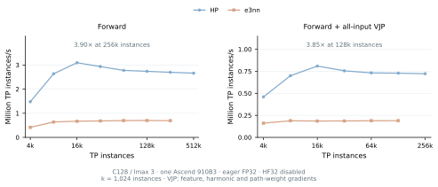
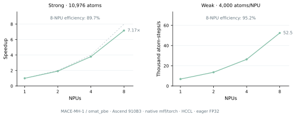

# ICTC-O3-HP-Ascend

High-performance ICTC-O3 operators optimized for Ascend NPUs, together with
MACE-ICTC for energy-and-force training, inference and molecular dynamics.

Version 0.1.0 · [MIT License](LICENSE)

Use `ictc_o3` independently in your own equivariant networks, or `mace_ictc`
to train, convert and deploy MACE potentials.

[Single-NPU results](#single-npu-results) · [Multi-NPU scaling](#multi-npu-scaling) ·
[Usage guide](docs/USAGE.md) · [O(3) API](docs/O3_API.md) ·
[LAMMPS](lammps_user_mfftorch/docs/ASCEND.md) · [All performance figures](docs/PERFORMANCE.md)

## Highlights

- Native Ascend C tensor products, graph messages and symmetric contractions,
  including the mixed second derivatives needed for force-loss training.
  Standalone TP throughput reaches 3.90× forward and 3.85× forward-plus-gradient
  throughput over e3nn.
- MACE training and energy-and-force inference reach up to 4.76× and 4.48×
  original PyTorch MACE/e3nn throughput at C128/lmax 3 and 2,048 atoms.
- Eight-NPU LAMMPS strong-scaling efficiency reaches 83.0% for C64 and 89.7%
  for pretrained MACE-MH-1. MH-1 weak-scaling efficiency reaches 95.2%.

All results use Ascend 910B3, eager FP32 and HF32 disabled, without `torch.compile`.
See the [measurement protocols and validation](docs/USAGE.md#benchmark-protocols-and-numerical-validation).

## Single-NPU results

### Standalone O(3) operators

C128/lmax 3 reaches 3.90× e3nn forward throughput at 262,144 TP instances
and 3.85× forward-plus-VJP throughput at 131,072 instances. VJP includes
feature, harmonic and path-weight gradients. See the
[four-configuration sweep](docs/PERFORMANCE.md#standalone-o3-tensor-products).

The separate [MindChemistry comparison](docs/PERFORMANCE.md#mindchemistry-comparison)
reaches 23.18× forward and 18.37× forward-plus-gradient throughput over
MindChemistry PyNative at C64/lmax 2 and 65,536 instances; Graph results are also shown.

### Training and inference

C64/lmax 2 with two interactions and correlation 3 reaches 18.4k atom-steps/s
in full training and 54.9k in energy-and-force inference: 3.66× and 3.63×
original MACE/e3nn at 8,192 and 16,384 atoms, respectively. Capacity inference
completes 196,608 atoms. Bars above the panels show the measured success-to-OOM
brackets. See [all four models](docs/PERFORMANCE.md#mace-model-sweep).

### Pretrained MACE-MH-1

Checkpoint conversion retains all six heads and supports energy-and-force
inference with `omat_pbe` selected. See the [single-NPU throughput and memory
comparison](docs/PERFORMANCE.md#pretrained-mace-mh-1) and the
[conversion recipe](docs/USAGE.md#6-use-mace-mh-1).

## Multi-NPU scaling

Both models use 1/2/4/8 NPUs on one node. Timings cover complete LAMMPS steps:
integration, dynamic neighbors, host/device transfers, energy, forces, virial
and HCCL communication.

### C64 scaling

At 32,768 atoms, C64/lmax 2 reaches 6.64× speedup and 83.0% efficiency on
eight NPUs, delivering 248.6k atom-steps/s. [Full results](lammps_user_mfftorch/docs/ASCEND.md#strong-scaling-and-memory)
also cover 4,096 and 13,824 atoms.

### MACE-MH-1 scaling

Strong scaling fixes 10,976 atoms: eight NPUs reach 7.17× speedup and 89.7%
efficiency. Weak scaling fixes 4,000 atoms/NPU: eight NPUs reach 95.2%
efficiency and 52.5k atom-steps/s at 32,000 atoms.
See the [full measurements and protocol](lammps_user_mfftorch/docs/ASCEND.md#mace-mh-1-scaling).

## License

Project-owned code and documentation use the [MIT License](LICENSE).
Third-party source, dependencies, pretrained weights and datasets retain their
original terms. See [LICENSE_SCOPE.md](LICENSE_SCOPE.md), [NOTICE](NOTICE) and
[UPSTREAM.md](UPSTREAM.md).
