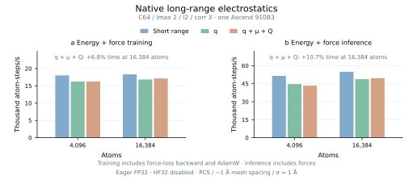

# ICTC-O3-HP-Ascend

High-performance ICTC-O3 operators optimized for Ascend NPUs, together with
MACE-ICTC for energy-and-force training, inference and molecular dynamics.

Version 0.1.0 · [MIT License](LICENSE)

Use `ictc_o3` independently in your own equivariant networks, or `mace_ictc`
to train, convert and deploy MACE potentials.

[Single-NPU results](#single-npu-results) · [Long-range electrostatics](#native-long-range-electrostatics) ·
[Multi-NPU scaling](#multi-npu-scaling) ·
[Usage guide](docs/USAGE.md) · [O(3) API](docs/O3_API.md) · [Electrostatics](docs/ELECTROSTATICS.md) ·
[LAMMPS](lammps_user_mfftorch/docs/ASCEND.md) · [All performance figures](docs/PERFORMANCE.md)

## Highlights

- Native Ascend C tensor products, graph messages and symmetric contractions,
  including the mixed second derivatives needed for force-loss training.
  Standalone TP throughput reaches 3.90× forward and 3.85× forward-plus-gradient
  throughput over e3nn.
- MACE training and energy-and-force inference reach up to 4.76× and 4.48×
  original PyTorch MACE/e3nn throughput at C128/lmax 3 and 2,048 atoms.
  C64 HCCL DDP training retains 98.9–99.4% weak-scaling efficiency on eight NPUs.
- Eight-NPU LAMMPS strong-scaling efficiency reaches 83.0% for C64 and 89.7%
  for pretrained MACE-MH-1. MH-1 weak-scaling efficiency reaches 95.2%.
- Native reciprocal monopole/dipole/quadrupole electrostatics: bounded mesh
  assignment, distributed multipole FFTs, mixed force-loss adjoints and HCCL.
  At 131,072 atoms on eight NPUs, slab FFTs accelerate complete q+μ+Q MD
  steps by 1.90×, raising weak-scaling efficiency from 36.8% to 70.5%.
  [Long-range results](#native-long-range-electrostatics).

All results use Ascend 910B3, eager FP32 and HF32 disabled, without `torch.compile`.
See the [measurement protocols and validation](docs/USAGE.md#benchmark-protocols-and-numerical-validation).

## Single-NPU results

### Standalone O(3) operators

C128/lmax 3 reaches 3.90× e3nn forward throughput at 262,144 TP instances
and 3.85× forward-plus-VJP throughput at 131,072 instances. VJP includes
feature, harmonic and path-weight gradients. See the
[four-configuration sweep](docs/PERFORMANCE.md#standalone-o3-tensor-products).

The separate [MindChemistry comparison](docs/PERFORMANCE.md#mindchemistry-comparison)
reaches 23.18× forward and 18.37× forward-plus-gradient throughput over
MindChemistry PyNative at C64/lmax 2 and 65,536 instances; Graph results are also shown.

### Training and inference

Columns show C64/lmax 2, C128/lmax 2, C128/lmax 3 and C256/lmax 3, each with
two interactions and correlation 3. Training is above; energy-and-force inference
is below, with separate performance and capacity modes.

C256/lmax 3 capacity inference reaches 5.53k atom-steps/s at 16,384 atoms.
See the [four-model memory curves](docs/PERFORMANCE.md#memory).

#### C64 capacity and memory

C64/lmax 2 reaches 18.4k atom-steps/s in full training and 54.9k in inference.
Capacity inference sustains 40.7–42.8k atom-steps/s from 16,384 to 229,376 atoms;
the first observed OOM is 262,144 atoms.

At 196,608 atoms, the capacity update reduces latency from 11.30 to 4.65 s
(2.43×) and peak allocated memory from 52.68 to 43.55 GiB.
[Full measurements and OOM brackets](docs/PERFORMANCE.md#c64-capacity-and-oom).

### Pretrained MACE-MH-1

Checkpoint conversion retains all six heads and supports energy-and-force
inference with `omat_pbe` selected. See the [single-NPU throughput and memory
comparison](docs/PERFORMANCE.md#pretrained-mace-mh-1) and the
[conversion recipe](docs/USAGE.md#6-use-mace-mh-1).

## Native long-range electrostatics

Learned monopole (`q`), dipole (`μ`) and quadrupole (`Q`) heads add a
Gaussian-screened reciprocal correction to MACE-ICTC. The standalone
`ictc_o3.MeshElectrostatics` API supports configurable source channels,
position and cell gradients, and the mixed derivatives needed for force training.

At 16,384 atoms, scalar q adds 5.2% to full training and 6.2% to energy-and-force
inference. Particle assignment reduces its extra training time by 40.6% and its
extra inference time by 51.2%. The retained q+μ+Q source/spectral sweep adds
6.8% and 10.7%, respectively.

These paired initialized-model measurements preserve the C64/lmax-2 backbone,
with two interactions, correlation 3, one source channel, PCS assignment,
approximately 1 Å mesh spacing and Gaussian width 1 Å. The figure combines the
scalar-q/short-range rerun with the retained q+μ+Q sweep. See the
[measurement protocol](docs/USAGE.md#long-range-training-and-inference).

Native `mff/torch` deployment partitions physical source atoms across ranks;
HCCL distributes multipole FFT slabs and their adjoints. Energy, force, virial
and MD checks pass at 1/2/4/8 NPUs, with additional coverage for empty ranks
and shifted box origins. [Train, restart, predict and deploy](docs/USAGE.md#train-with-long-range-electrostatics) ·
[Standalone API and physical conventions](docs/ELECTROSTATICS.md).

## Multi-NPU scaling

LAMMPS measurements use 1/2/4/8 NPUs on one node and cover complete steps:
integration, dynamic neighbors, host/device transfers, energy, forces, virial
and HCCL communication. DDP training is measured separately below.

### C64 scaling

At 32,768 atoms, C64/lmax 2 reaches 6.64× speedup and 83.0% efficiency on
eight NPUs, delivering 248.6k atom-steps/s. [Full results](lammps_user_mfftorch/docs/ASCEND.md#strong-scaling-and-memory)
also cover 4,096 and 13,824 atoms.

### MACE-MH-1 scaling

Strong scaling fixes 10,976 atoms: eight NPUs reach 7.17× speedup and 89.7%
efficiency. Weak scaling fixes 4,000 atoms/NPU: eight NPUs reach 95.2%
efficiency and 52.5k atom-steps/s at 32,000 atoms.
See the [full measurements and protocol](lammps_user_mfftorch/docs/ASCEND.md#mace-mh-1-scaling).

### Long-range LAMMPS scaling

Strong scaling fixes 32,768 atoms; weak scaling fixes 16,384 atoms/NPU.
On eight NPUs, q+μ reaches 61.8% strong and 76.4% weak efficiency;
q+μ+Q reaches 59.8% and 70.5%, delivering 109.4k and 129.5k atom-steps/s.
Distributed multipole FFTs reduce the 131,072-atom q+μ+Q step from
1,927 to 1,012 ms with the same checkpoint, mesh and FP32 precision.
All four series share the saved C64 backbone, PCS, Gaussian width 1 Å and
0.5 Å mesh spacing, rebuilding neighbors every step.
[Full measurements and protocol](docs/ELECTROSTATICS.md#multi-npu-scaling).

### Long-range DDP training

Strong scaling fixes 16,384 atoms in eight independent 2,048-atom graphs.
Weak scaling fixes 8,192 atoms/NPU in four graphs/NPU. Each step includes
energy-and-force loss, mixed parameter backward, HCCL gradient synchronization
and AdamW. On eight NPUs, q+μ+Q reaches 66.1% strong and 98.9% weak efficiency,
delivering 79.0k and 117.6k atom-steps/s.
[DDP training recipe](docs/USAGE.md#multi-npu-training-with-hccl) ·
[All measurements and protocol](docs/ELECTROSTATICS.md#ddp-training-scaling).

## License

Project-owned code and documentation use the [MIT License](LICENSE).
Third-party source, dependencies, pretrained weights and datasets retain their
original terms. See [LICENSE_SCOPE.md](LICENSE_SCOPE.md), [NOTICE](NOTICE) and
[UPSTREAM.md](UPSTREAM.md).
