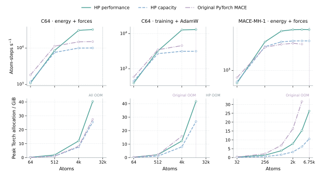

# ICTC-O3-HP-Ascend

High-performance ICTC-O3 operators optimized for Ascend NPUs, together with the
MACE-ICTC framework for atomistic modeling, training and inference.

Version 0.1.0. Distribution: `ictc-o3-hp-ascend`. The `ictc_o3` and `mace_ictc`
Python packages are installed together.

## Highlights

- Weighted O(3) tensor products: 23.18× faster forward and 18.37× faster forward
  plus input gradients than MindChemistry PyNative on Ascend 910B3.
- MACE training and inference: 2.80× faster full energy-and-force training and
  2.15× faster inference than original PyTorch MACE at the reported C64 points.
- Official MACE-MH-1: all six heads retained, 2.05× faster energy-and-force
  inference; capacity mode uses 6.13 GiB versus 31.71 GiB at 4,000 atoms.
- Multi-NPU LAMMPS: 6.64× speedup and 83.0% efficiency on eight NPUs,
  reaching 248,559 atom-steps/s at 32,768 atoms.
- Dynamic execution: changing atom counts and neighbor graphs, runtime model
  hyperparameters, and hardware-derived UB tiling for Ascend C kernels.

## Performance on Ascend

All results use Ascend 910B3 and FP32 with HF32 disabled. Performance mode
prioritizes throughput; capacity inference uses chunk recomputation to bound
intermediate storage. Chunk sizes adapt to tensor widths and available device
memory. The figures below report measurements from the v0.1.0 release.

### O(3) operators


At C64/lmax 2 and 65,536 edges, an isolated repeat measures 12.20 ms versus
282.92 ms for the weighted tensor-product forward, and 45.12 ms versus
828.93 ms for forward plus gradients of all three inputs: 23.18× and 18.37×
speedups over MindChemistry PyNative. The curves cover C64 and C128, angular
degrees 1–3, both HP modes and both MindSpore PyNative and Graph execution.

### MACE training, inference and memory



The same initialized MACE weights yield 2.15× faster energy-and-force inference
at 13,824 atoms and 2.80× faster full training at 4,096 atoms. Training includes
the energy-and-force loss, mixed second derivatives, AdamW and `zero_grad`.

Official MACE-MH-1 inference reaches 7,440 atom-steps/s at 4,000 atoms in
performance mode, a 2.05× speedup. Capacity mode reaches 4,265 atom-steps/s and
reduces peak Torch allocation from 31.71 GiB to 6.13 GiB. Both HP modes complete
the 6,912-atom sample; original PyTorch MACE reaches OOM there.

Standalone factory-model sweeps also complete 65,536-atom C64/lmax-2 inference
in capacity mode, and 16,384-atom full C64/lmax-2 training in performance mode.

### Multi-NPU molecular dynamics


At 32,768 atoms, the C64/lmax-2/two-interaction/correlation-3 model reaches
6.64× speedup on eight NPUs: 83.0% efficiency, 131.83 ms per complete MD step
and 248,559 atom-steps/s. Timing includes CPU integration, neighbor work,
transfers, energy, forces and communication. HCCL exchanges intermediate
features, their adjoints and ghost-force contributions between NPUs.

<details>
<summary>Benchmark setup and numerical checks</summary>

O(3) operators use unchanged MindChemistry 0.2.0 from the official
[`r0.7` source](https://github.com/mindspore-ai/mindscience/tree/b233dc1ab152dfe29e0ff2cafb55c780dff34c67/MindChemistry)
with MindSpore 2.10.0. The path-preserving `uvu` tensor products match
natural-parity coupling paths, normalization, channel counts and live external
path weights. Forward + VJP includes gradients of features, direction harmonics
and path weights. Each point is the median of five synchronized calls after
three warmups. Graph compilation is performed separately for each measured
shape and excluded from timing. The PyNative C128/lmax-3 VJP endpoint reaches
OOM at 65,536 edges. CPU FP64 basis/path checks and input gradients agree to
relative errors around `1e-7`.

The whole-model baseline uses original `mace-torch==0.3.14` and `e3nn==0.5.9`,
with its usual scripted operators and no `torch.compile`. The initialized model
uses C64, lmax 2, two interactions, correlation 3, full CG paths, eight Bessel
functions, a 4.5 Å cutoff and 56 directed neighbors per atom. MH-1 uses the
same official checkpoint, the `omat_pbe` head, a 6 Å cutoff and 78 neighbors per
atom. Inference freezes parameters and computes both energy and forces.
Each point is the median of five synchronized calls after two warmups.
Training restores initial weights outside the timed step. Peak Torch allocation
includes resident models, graphs, optimizer state and that fixed snapshot;
external CANN and driver allocations are excluded. OOM markers identify the
first failed sample. Model comparisons use one NPU per model; graph construction,
neighbor lists, transfers and compilation are outside timing. Eight-NPU
allocations run independent workers. Factory-model capacity samples use a
separate initialized model and sweep.

Multi-NPU results use complete dynamic LAMMPS runs on one eight-NPU node,
with 1/2/4/8 active NPUs, a 4.5 Šcutoff, 0.5 Šskin and 0.125 atoms/ų.
There are initially 56 physical neighbors and 80 cached skin edges per atom.
Points are median complete loop times from three ten-step runs after five
warmup steps. Compact owned outputs and native gathers are enabled. The
[deployment guide](lammps_user_mfftorch/docs/ASCEND.md#measured-md-performance)
provides the complete latency, throughput and memory measurements.

Validation covers energies, forces, force-loss parameter gradients and position
gradients against CPU FP64 for four model configurations, as well as partial
inputs, empty graphs, channel tails and derivatives through third order.
Full-model checks compare energies, forces and parameters after 70 AdamW updates.
MH-1 conversion is checked for all six heads on periodic Cu and mixed H/C/O.
LAMMPS checks cover global virial, both Newton settings, changing ownership,
empty ranks, triclinic cells and large coordinate offsets. Core model checks use
relative L2 `1e-4` and componentwise `atol=2e-5`, `rtol=1e-4`; MH-1 deployment
uses those componentwise tolerances and the corresponding combined norm budget.

</details>

## Installation

Use a dedicated Linux environment with matching Ascend drivers and CANN.
The development stack is CANN 9.0.0, Python 3.10, PyTorch 2.7.1,
`torch_npu` 2.7.1.post4 and Triton-Ascend 3.2.1. Source the CANN environment,
then install and build on an allocated compute node:

```bash
git clone https://github.com/Parity-LRX/ICTC-O3-HP-Ascend.git
cd ICTC-O3-HP-Ascend
python -m pip install 'torch==2.7.1' 'torch_npu==2.7.1.post4'
python -m pip install -e '.[train,conversion]'
python -m pip install 'triton-ascend==3.2.1' pybind11 'cmake>=3.16' ninja \
  --extra-index-url=https://triton-ascend.osinfra.cn/pypi/simple
python -m mace_ictc.ascendc.build --output /path/to/build/ictc_ascendc --jobs 4
export ICTC_ASCENDC_LIBRARY=/path/to/build/ictc_ascendc/libictc_ascendc.so
```

Triton-Ascend supplies the `triton` namespace; install it after packages that
may install community Triton. On Slurm clusters, use `sbatch` for compilation
and numerical execution.

## Python API

The public packages live side by side:

```text
ictc_o3/       # Standalone O(3) operators
mace_ictc/     # Models, training, conversion and deployment
```

### Standalone operators

```python
import torch
import torch_npu
from ictc_o3 import EdgeTensorProduct, direction_harmonics
from mace_ictc.ascendc import enable

enable(mode='performance')
op = EdgeTensorProduct.create(channels=64, input_lmax=2, edge_lmax=2)
features = torch.randn(1024, 64*9, device='npu', requires_grad=True)
directions = torch.nn.functional.normalize(torch.randn(1024, 3, device='npu'), dim=-1)
harmonics = torch.cat(direction_harmonics(directions, 2, policy='generated'), -1)
gates = torch.randn(1024, op.gate_width, device='npu', requires_grad=True)
output = op(features, harmonics, gates)
```

Ascend C covers tensor products, graph messages, symmetric contractions,
direction harmonics, nonlinearities and channel transforms. First and mixed
second adjoints support energy-and-force training. Native tiling accounts for
UB queues, workspaces and coupling metadata, including odd channels and tails.
See the [operator API](docs/HP_API.md) for shapes, derivatives and schedules.

### Training and inference

```python
import torch
import torch_npu
from mace_ictc.ascendc import enable
from mace_ictc.hp import create_model, configure_model, energy_and_forces

enable(mode='performance')  # Use 'capacity' for smaller intermediates.
model = create_model(
    channels=64, lmax=2, num_interactions=2, correlation=3, device='npu',
)
configure_model(model, training=True, policy='generated')
optimizer = torch.optim.AdamW(model.parameters(), lr=1e-3, foreach=False)

# graph: positions, atomic_numbers, batch, edge_src, edge_dst,
# lattice edge_shifts and cell [B,3,3], all on the NPU.
prediction = energy_and_forces(model, **graph, training=True)
loss = (prediction['energy'] - reference_energy).square().mean() \
     + (prediction['forces'] - reference_forces).square().mean()
loss.backward()
optimizer.step()
optimizer.zero_grad(set_to_none=True)

model.eval().requires_grad_(False)
configure_model(model, policy='generated')
prediction = energy_and_forces(model, **graph)
```

Run [`examples/model.py`](examples/model.py) for a complete synthetic training
step, adding `--ascendc --ascendc-mode performance` to select the built library.
The [model API](docs/HP_API.md#whole-models) describes graph inputs, trainer
configuration and checkpoint handling.

## Pretrained MACE and LAMMPS

Convert an official MACE-MH-1 checkpoint:

```bash
ictc-ascend-convert-foundation \
  --mace-model /path/to/mace-mh-1.model --head omat_pbe \
  --dtype float32 --out /path/to/mh1-ictc-ascend.pt
```

The conversion retains all six heads, Agnesi distance transforms, ZBL repulsion,
density normalization and nonlinear residuals. The foundation adapter supports
frozen energy-and-force inference. The [conversion guide](docs/CONVERSION.md)
provides checkpoint download, head selection, Python prediction and standard
MACE conversion examples.

The plain `mff/torch` interface runs a persistent model per MPI rank with HCCL
feature and force exchange. Example for a Cu model with a 6 Å cutoff:

```lammps
units metal
atom_style atomic
read_data cu.data
pair_style mff/torch 6.0 npu
pair_coeff * * /path/to/mh1-ictc-ascend.pt Cu
```

See the [Ascend LAMMPS guide](lammps_user_mfftorch/docs/ASCEND.md) for compilation,
MPI/HCCL launch, ordinary training checkpoints and complete MD inputs.

## License

The original project's PolyForm Noncommercial and preserved MIT scopes are retained.
See [LICENSE](LICENSE), [LICENSE_SCOPE.md](LICENSE_SCOPE.md), [NOTICE](NOTICE)
and [upstream provenance](UPSTREAM.md).
