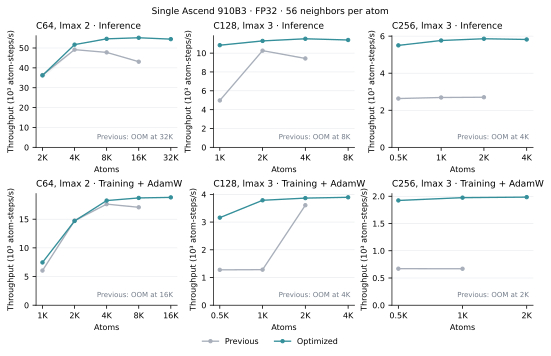
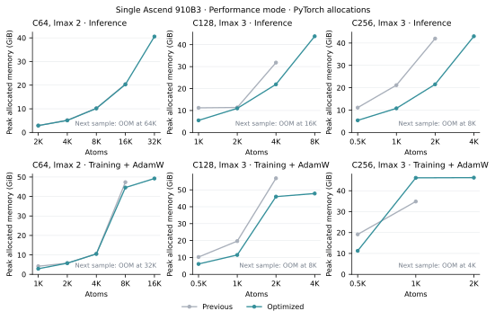

# ICTC-O3-HP-Ascend

ICTC-O3 Cartesian tensor operators and the MACE-ICTC framework for Ascend NPUs.
Ascend C kernels cover tensor products, fused graph messages, symmetric
contractions, direction harmonics, nonlinearities and FP32 channel transforms.
Hardware-derived UB tiling supports odd channel counts, tails and streamed
coupling tables. Performance and capacity modes combine these kernels with
CANN GEMMs according to the measured workload.

Version 0.1.0. Distribution: `ictc-o3-hp-ascend`. Python packages: `ictc_o3`
for standalone operators and `mace_ictc` for models, training and checkpoints.
This is an independent port of [ICTC-O3-HP](https://github.com/Parity-LRX/ICTC-O3-HP).

## Install

Use a dedicated Linux environment with a matching Ascend driver, CANN Toolkit,
CANN operators and PyTorch NPU extension. The development stack is Ascend 910B3,
CANN 9.0.0, Python 3.10, PyTorch 2.7.1, torch_npu 2.7.1.post4 and
Triton-Ascend 3.2.1. Source the site's CANN environment before running Python.

```bash
python -m pip install 'torch==2.7.1' 'torch_npu==2.7.1.post4'
python -m pip install 'triton-ascend==3.2.1' pybind11 \
  --extra-index-url=https://triton-ascend.osinfra.cn/pypi/simple
python -m pip install -e '.[train]'
python -m pip install 'cmake>=3.16' ninja
python -m mace_ictc.ascendc.build --output /path/to/build/ictc_ascendc --jobs 4
export ICTC_ASCENDC_LIBRARY=/path/to/build/ictc_ascendc/libictc_ascendc.so
```

Triton-Ascend supplies the `triton` namespace. Install it after other packages
that may install community Triton, and check that its Ascend backend is present.
Avoid installing another `mace_ictc` checkout into the same environment.
On a cluster, run compilation and all examples in a scheduled compute allocation.
Use node-local temporary storage for compiler scratch when shared-storage
unlink semantics cause compiler cleanup errors.

## Whole-model training and inference

```python
import torch
import torch_npu
from mace_ictc.hp import create_model, configure_model, energy_and_forces
from mace_ictc.ascendc import enable

enable(mode='performance')  # 'capacity' saves memory; 'native' uses custom Cube GEMMs

model = create_model(
    channels=64, lmax=2, num_interactions=2, correlation=3, device='npu',
)
plan = configure_model(model, training=True, policy='generated')
optimizer = torch.optim.AdamW(model.parameters(), lr=1e-3, foreach=False)

# graph contains positions, atomic_numbers, batch, edge_src, edge_dst,
# edge_shifts in lattice coordinates, and cell [B,3,3], all on the NPU.
prediction = energy_and_forces(model, **graph, training=True)
loss = (prediction['energy'] - reference_energy).square().mean() \
     + (prediction['forces'] - reference_forces).square().mean()
loss.backward()
optimizer.step()
optimizer.zero_grad(set_to_none=True)

model.eval().requires_grad_(False)
configure_model(model, policy='generated')
prediction = energy_and_forces(model, **graph)
```

The factory creates initialized weights. It does not provide a trained potential.
`policy='reference'` selects the inherited differentiable PyTorch implementation;
`policy='generated'` requires NPU coverage and reports unsupported configurations.
Run [`examples/model.py`](examples/model.py) for a complete synthetic training step.
Add `--ascendc --ascendc-mode performance` to use the built library. The default
without `enable()` retains the Triton/GEMM implementation.

## Standalone O3 operators

```python
import torch
import torch_npu
from ictc_o3 import EdgeTensorProduct, direction_harmonics
from mace_ictc.ascendc import enable

enable(mode='capacity')

op = EdgeTensorProduct.create(channels=64, input_lmax=2, edge_lmax=2)
features = torch.randn(1024, 64*9, device='npu', requires_grad=True)
directions = torch.nn.functional.normalize(torch.randn(1024, 3, device='npu'), dim=-1)
harmonics = torch.cat(direction_harmonics(directions, 2, policy='generated'), -1)
gates = torch.randn(1024, op.gate_width, device='npu', requires_grad=True)
output = op(features, harmonics, gates)
```

See [the API guide](docs/HP_API.md) for buffer layouts, graph messages,
species banks and symmetric contractions, and [the upstream provenance](UPSTREAM.md).

## Backend design and scope

- Tensor products share geometry projections across channels, consume the original
  ICTC coupling constants and preserve path order.
- Symmetric contractions share CG prefixes and read species weights directly, without
  materializing a node-sized path-weight bank or sorting nodes by species.
- Native vector schedules account for input/output queue storage, work vectors, gather and
  graph indices, masks and coupling metadata before selecting row/channel tiles.
  The tested 910B3 reports 196,352 available UB bytes and 40 Vector Cores. The
  generic multilinear maps reserve one sixth of reported UB, rounded up to
  4 KiB. Graph epilogues and narrow matrix adjoints use a 4 KiB guard after
  accounting for their explicit queues and workspaces. These are
  scheduling choices, with no fixed model hyperparameters.
- Learned weight names and shapes are retained; configuration does not freeze or cast parameters.
- Performance graph messages keep channels contiguous, group paths by their
  actual input angular degree and apply one GEMM per group. Constant geometry
  columns are reordered without padding; live path gates and output order are
  retained. Node-sized transforms and grouped path splits reduce edge-sized copies
  and slice-adjoint zero fills. Shared chunk splits join harmonic/gate gradients
  across the graph. Large working sets use a Vector epilogue for
  path gates and FP32 destination accumulation. Its first and mixed second
  adjoints keep channels contiguous across the autograd boundary. Adjacent output
  intervals share DMA transfers; only constant projection columns are reordered.
  First adjoints share node cotangent transfers. Mixed second adjoints compute
  their requested edge gradients and combined node accumulation in one kernel.
  Tiling budgets all active operands and outputs; unsupported tiles retain
  separate adjoints. Small workloads retain the established path.
  Each input-degree group reuses a private compact node accumulator across
  edge chunks; node-sized angular reordering restores the public path order once.
  This keeps graph transfers contiguous without changing coupling coefficients.
  Narrow batched adjoints
  use bounded Vector schedules where applicable, with CANN fallback.
  Tiles spanning the full channel axis coalesce contiguous angular rows into
  single DMA blocks. Channel tails and separated rows retain strided transfers.
  Recursive matrix adjoints retain live first, mixed second and higher derivatives. Standalone edge products
  retain their analytic path adjoints; symmetric contractions use analytic first
  and mixed second adjoints with differentiable higher-order formulas.
- The quadratic prefix of symmetric contraction shares one combined input
  adjoint. Performance-mode geometry uses row gathers and a single-cell matrix
  product while retaining derivatives of positions, cells and periodic shifts.
- Capacity mode fuses source gathering, tensor products and FP32 atomic
  destination accumulation, with analytic first and mixed second adjoints.
  Native mode additionally selects custom strict-FP32 Cube matrix kernels.
  Both transpose flags and wide ND transfer strides are handled explicitly.
- Channels, element count, interaction depth and graph size are runtime parameters.
  Native symmetric contractions currently cover correlation orders 1, 2 and 3.
- Whole-model edge chunks are sized from the actual channel, angular and path widths.
  Set `message_chunk_edges=16384` for smaller forward intermediates; automatic sizing
  favors throughput and can increase the allocation peak. See the API guide for
  the scratch estimate. Performance mode combines grouped GEMMs with a native
  gate/reduction epilogue where its working set is large enough; smaller messages
  retain PyTorch accumulation. Capacity/native modes also fuse the tensor product
  itself inside Ascend C kernels.
- Performance mode applies stream backpressure near the device allocation
  budget, including inside native adjoints. Very large energy/force calls finish
  marked streams before returning. The triggers use live allocations, actual
  message widths and total device memory; ordinary workloads retain pipeline
  overlap. The default operator task queue is preserved. See the API guide for
  the scheduling override and latency scope.
- FP32 execution disables HF32 and requires autocast to be off. No reduced-precision
  approximation is used.

Ordinary framework layout operations, loss construction, small broadcast
products and some reductions still use PyTorch NPU. A full native execution
option is provided for tuning; it is slower than the selected vendor-GEMM
combination at the measured points.

Standalone model execution is eager. The plain Ascend `mff/torch` LAMMPS backend runs one
persistent model per MPI rank, with Ascend C packing and accumulation and HCCL
communication between NPUs. Multi-rank runs default to a single-cutoff halo
with feature and adjoint exchange. LAMMPS retains host integration, neighbor
lists, domain decomposition and atom migration. See the
[Ascend LAMMPS guide](lammps_user_mfftorch/docs/ASCEND.md) for the build,
checkpoint requirements, examples and qualification scope.
Execution is dynamic eager: atom counts, neighbor edges and owner schedules
can change without capturing or replaying a fixed-shape program.
The eager C64/lmax2/two-interaction/correlation3 model reaches 5.27x strong scaling
on eight NPUs at 13,824 atoms (65.8% efficiency). The guide also records the
lower efficiency of the 4,096-atom point and matched direct-PyTorch timings.

Compiled export and long-range electrostatics are not qualified on Ascend.
Inherited CUDA sources remain available for compatibility and reference; their
presence does not establish NPU support.

## Numerical validation

On an Ascend 910B3, four initialized model configurations cover angular degrees
1–3, correlation orders 1–3 and one to three interactions. Energies, forces and
the parameter and position gradients of the energy-and-force loss pass CPU FP64
comparisons. The latest performance-mode qualification requires relative L2 error
at most `1e-4` and pointwise error at most `2e-5 + 1e-4 * abs(reference)`.

Validation also covers 28 sparse-operator checks, both packed layouts, chunked
masked graph messages, empty graphs, mutable species metadata, rectangular
channel transforms for multiple atomic species and an energy-and-force trainer
step with AdamW. Native Cube checks include every transpose/bias combination,
frozen operands and mixed derivatives, including a reduction width of 65,537.
Nonlinearity, direction-polynomial and recursive batched-matrix checks include
third derivatives. Grouped graph messages also pass third-order checks with live
path coefficients, trainable masks, unequal input/edge/output degrees and both
packed layouts. Native graph epilogues additionally cover 1, 7, 17, 64 and 129
channels, fixed masks, frozen operands and strided graph indices through third
derivatives. Fused adjoints also cover every requested output subset, missing
higher-adjoint inputs and strided input views against FP64. These checks use
synthetic inputs and do not establish the accuracy of a fitted potential.
The kernel suite also covers 204 batched-matrix cases, single-input quadratic
derivatives and single/multiple-cell geometry through third derivatives,
including live cell and periodic-shift inputs. Chunk-accumulator checks cover
15 live/frozen input subsets through third derivatives. Full-model checks also
compare energies, forces and learned parameters after 70 AdamW updates.

## Training and inference performance

One active Ascend 910B3, eager FP32 with HF32 disabled. Initialized models use
two interactions, correlation order 3 and 56 directed neighbors per atom.
Previous and optimized schedules use identical weights and graphs at each point.
Previous denotes the preceding production schedules.



Top: inference with energy and forces. Bottom: complete energy-and-force loss,
second-order backward, AdamW and `zero_grad`. Points are medians of three rounds;
shading shows the measured round range. `K` denotes 1,024 atoms. The previous
schedule is shown only where it completed the measurement. Training throughput
increases across all sampled sizes in the four surveyed model configurations.
Inference reaches a plateau, with remaining endpoint declines of about 0.7–1.3%.
Throughput counts atoms processed per energy-and-force call or full training step.



Memory curves show total PyTorch allocation peaks for one resident model, graph
and optimizer where applicable. Driver and external CANN allocations are excluded.
OOM labels identify the next failed sample, not an exact capacity limit.
Wide-model training can trade additional activation storage for faster execution.

Largest successful samples in performance mode:

- C64/lmax 2: 32,768 atoms for inference and
  16,384 for full training.
- C128/lmax 3: 8,192 atoms for inference and
  4,096 for full training.
- C256/lmax 3: 4,096 atoms for inference and
  2,048 for full training.

A separate capacity-mode sweep, with synchronization after every call, reaches
65,536 atoms for C64/lmax 2 and
16,384 for C256/lmax 3. Capacity mode
uses a different operator schedule and is slower. Near full memory, the measured
C256/lmax-3 capacity throughput decreases by about 0.8% from 8,192 to 16,384 atoms.

### Matched single-device K100 comparison

This separate C64/lmax-2 measurement uses 4,096 atoms and loads the same saved
weights, exact graph and trainable parameter set on one K100. Loss, AdamW and
timing protocol match. Both devices use eager FP32 with HF32/TF32 disabled.

| Operation | K100 (ms) | Ascend 910B3 (ms) | Ascend / K100 latency |
| --- | ---: | ---: | ---: |
| Inference (energy + forces) | 40.63 | 79.82 | 1.965× |
| Training + AdamW | 112.68 | 226.87 | 2.013× |

These ratios describe this initialized model and fixed graph.
Across 18 paired points at 512 or 4,096 atoms, the largest measured latency
regression is 1.91%.

### Sustained training and timing scope

A separate 64-step check uses six warmups, alternating 16-step blocks, per-step
synchronization and Python garbage collection enabled. C64 mean training time
changes from 242.92 to 235.07 ms,
with current throughput 17,425 atom-steps/s.
Final energies, forces and learned parameters pass the post-update comparison.

The primary and scaling protocol uses three warmups followed by three
alternating paired rounds of three calls. Runtime configuration, graph creation,
neighbor rebuilding, JIT compilation and transfers are outside timing. Runtime
stream synchronization for large messages is included. Inference freezes model
weights and computes forces through autograd. The graph is a periodic perturbed
lattice at 0.125 atoms/ų with a 4.5 Šcutoff. Each model runs on one NPU; the
eight-device allocation runs independent workers, rather than distributed models.
Paired points check energies, forces and training parameter gradients before
timing. Candidate-only samples beyond a reference OOM additionally require finite
outputs; their status is retained separately from completed paired measurements.

## License

The original project's PolyForm Noncommercial and preserved MIT scopes are retained.
See [LICENSE](LICENSE), [LICENSE_SCOPE.md](LICENSE_SCOPE.md) and [NOTICE](NOTICE).
