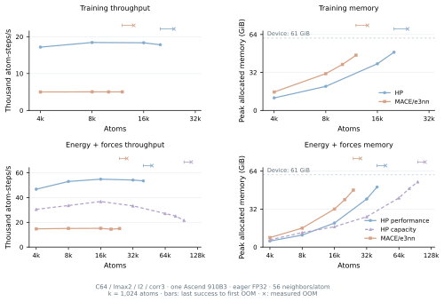
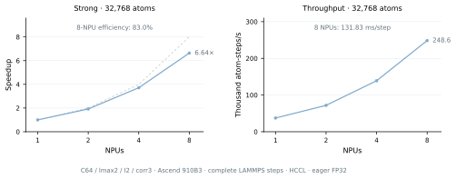

# ICTC-O3-HP-Ascend

High-performance ICTC-O3 operators and the MACE-ICTC framework, optimized for
Ascend NPUs with native Ascend C kernels.

Version 0.1.0 · [MIT License](LICENSE)

For installation, O(3) and model APIs, training, checkpoint conversion and
LAMMPS deployment, see the [Usage guide](docs/USAGE.md).

## Highlights

- MACE energy-and-force training: up to 4.76× the throughput of original
  PyTorch MACE/e3nn, including force-loss backward and AdamW.
- Energy-and-force inference: up to 4.48× faster than original MACE/e3nn;
  C64/lmax 2 reaches 54.8k atom-steps/s.
- Standalone O(3) tensor products: up to 3.90× forward and 3.85×
  forward-plus-gradient throughput over e3nn; 23.18× and 18.37× over
  MindChemistry PyNative at C64/lmax 2.
- Eight-NPU MD: 6.64× speedup, 83.0% efficiency and 248,559 atom-steps/s
  for a complete 32,768-atom LAMMPS step.

Results use Ascend 910B3, eager FP32 and HF32 disabled, without `torch.compile`.

## Training and inference

At C64/lmax 2, inference reaches 54,823 atom-steps/s at 16,384 atoms,
3.62× original MACE/e3nn. Full training reaches 18,486 atom-steps/s at
8,192 atoms, a 3.67× speedup. Capacity inference completes 65,536 atoms.

Throughput and memory across four model configurations

The scan covers C64/lmax 2, C128/lmax 2, C128/lmax 3 and C256/lmax 3,
with two residual interactions and correlation 3. At C128/lmax 3 and
2,048 atoms, HP reaches 4.48× inference and 4.76× training throughput
over original MACE/e3nn.

Curves connect measured sizes. Crosses mark observed e3nn and performance-mode
OOM sizes; capacity curves end at their last successful sample.

## Multi-NPU scaling

Strong scaling fixes 32,768 atoms and uses 1/2/4/8 NPUs on one node.
The C64/lmax-2/two-interaction/correlation-3 model reaches 6.64× speedup
and 83.0% efficiency on eight NPUs: 131.83 ms per step and
248,559 atom-steps/s. Timing includes integration, neighbors, transfers,
energy, forces and HCCL communication.

## Standalone O(3) operators

At the largest shared sizes across four configurations, HP delivers
1.87–3.90× e3nn's forward throughput and 2.19–3.85× its forward-plus-VJP
throughput. C128/lmax 3 reaches 2.70 million TP instances/s.
VJP includes gradients of features, direction harmonics and path weights.

Against MindChemistry PyNative at C64/lmax 2 and 65,536 edges, HP reaches
23.18× forward and 18.37× forward-plus-gradient throughput.
The figure also includes MindSpore Graph execution.

## Pretrained MACE-MH-1

With all six heads retained and `omat_pbe` selected, performance inference
reaches 7,440 atom-steps/s at 4,000 atoms, 2.05× original PyTorch MACE.
At that size, capacity mode uses 6.13 GiB versus 31.71 GiB for original MACE.
Both HP modes complete the 6,912-atom sample, where original MACE reaches OOM.

## License

ICTC-O3-HP-Ascend project-owned code and documentation are licensed under the
[MIT License](LICENSE). Third-party source notices, dependencies, pretrained
weights and datasets retain their original terms. See
[LICENSE_SCOPE.md](LICENSE_SCOPE.md), [NOTICE](NOTICE) and [UPSTREAM.md](UPSTREAM.md).
