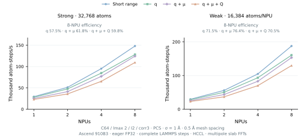
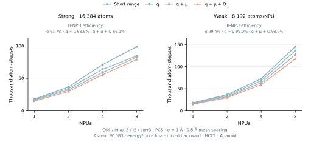

# High-performance reciprocal electrostatics on Ascend

The standalone `ictc_o3` API and MACE-ICTC share bounded mesh assignment,
analytic adjoints, NPU real FFT and fused Cartesian multipole contraction.
Ascend C and Triton-Ascend schedules use eager FP32 with HF32 disabled. Mesh dimensions,
atom counts, source channels and neighbor graphs are runtime inputs; no graph
capture or fixed atom capacity is required.

## Install

Follow the [installation and native build instructions](O3_API.md#1-install-and-enable-the-high-performance-backend).
Rebuild `libictc_ascendc.so` with the electrostatic kernels, and set
`ICTC_ASCENDC_LIBRARY` to the resulting library. Run numerical examples inside
your Ascend compute allocation; use `sbatch` on a Slurm cluster.

## Standalone API

```python
import torch
import torch_npu
from ictc_o3 import MeshElectrostatics, mesh_shape_for_cell
from ictc_o3.ascendc import enable

torch.npu.set_device(0)
enable(mode="performance")

# Cell rows are lattice vectors. Select the mesh once at setup time.
cell = torch.diag(torch.tensor([16., 20., 24.], device="npu"))[None]
mesh = mesh_shape_for_cell(cell, spacing=1.0)
solver = MeshElectrostatics(
    mesh_size=mesh, smearing_sigma=1.0, assignment="pcs", backend="ascend",
).npu()
positions = (torch.rand(128, 3, device="npu") @ cell[0]).requires_grad_()
batch = torch.zeros(128, dtype=torch.int64, device="npu")
q = torch.randn(128, 2, device="npu", requires_grad=True)
mu = torch.randn(128, 2, 3, device="npu", requires_grad=True)
Q = torch.randn(128, 2, 3, 3, device="npu", requires_grad=True)

atomic_energy = solver(positions, batch, cell, q, dipole=mu, quadrupole=Q)
energy = atomic_energy.sum()
forces = -torch.autograd.grad(energy, positions, create_graph=True)[0]
loss = energy.square() / 128**2 + forces.square().mean()
loss.backward()  # Includes force-loss gradients of q, mu and Q.
```

Omit `dipole` and `quadrupole` for scalar sources. Omit only `quadrupole` for
monopoles and dipoles. Use the same coordinate units for the cell, positions
and `smearing_sigma`. These learned sources have the normalization of the
training functional; they are not automatically physical charges in electron
units. The caller supplies any required physical unit conversion.

| Argument | Shape / meaning |
| --- | --- |
| `positions` | `[N,3]`, Cartesian coordinates |
| `batch` | `[N]`, int64 graph IDs in `[0,B)` |
| `cell` | `[B,3,3]`, nonsingular row-vector cells |
| `q` | `[N,S]`, required scalar sources |
| `dipole` | Optional `[N,S,3]` Cartesian moments |
| `quadrupole` | Optional `[N,S,3,3]` Cartesian moments |
| Output | `[N,1]`, atomic energy contributions |

`mesh_size=M` retains the cubic `M³` convention; `(Mx,My,Mz)` selects a
rectangular grid. `mesh_shape_for_cell` rounds dimensions to FFT-friendly
2/3/5-smooth sizes. It synchronizes and detaches the cell, so call it during
setup and keep the mesh fixed while differentiating coordinates or strain.

`backend="ascend"` requires NPU FP32 and the native library. `"auto"` selects
that path when available and otherwise uses the differentiable Torch reference.
`"reference"` explicitly selects the reference, including CPU FP64. Native
adjoints support energies, forces, cell derivatives and mixed second derivatives;
use the reference for derivatives beyond second order. Floating atomic sums
are nondeterministic, as with other mesh scatter implementations.

Low-level `mesh_spread` and `mesh_gather` are also exported from `ictc_o3`.
They take fractional coordinates, graph IDs, `mesh_size`, `num_graphs` and
`assignment="cic"|"tsc"|"pcs"`. The default mesh layout is `[B,Mx,My,Mz,S]`;
`channels_first=True` selects `[B,S,Mx,My,Mz]`.

## Functional and compatibility

The default is a Gaussian-screened **reciprocal correction** with spectral
factor `exp(-sigma² |k|² / 2)`, B-spline window deconvolution and the zero mode
removed. It does not include real-space pairs, self energy or a neutralizing
background term. The inherited `full_ewald` option enables Gaussian screening;
its name alone does not make this standalone correction a complete Ewald sum.

Scalar sources are neutralized per graph by default. Scalar atomic energies
use the source-times-potential partition; multipole graph energies are divided
uniformly among atoms. Both give the same graph-energy and force conventions
as the K100 implementation. Triclinic real FFTs retain the two distinct folded
Nyquist contributions.

`smearing_sigma=1.0` is a fixed length for new API models. `None` preserves
the older box-dependent screening convention. Existing checkpoint loading does
not silently introduce a new sigma. Choose mesh resolution and sigma for the
trained functional and verify convergence; changing them changes the potential.
`boundary="slab"` retains the inherited padded-cell approximation with
`slab_padding_factor`, rather than a separate open-boundary Poisson solver.

## MACE-ICTC model and training

```python
import torch
from mace_ictc.hp import create_model, configure_model, energy_and_forces

model = create_model(
    channels=64, lmax=2, edge_lmax=2, num_interactions=2, correlation=3,
    cutoff=4.5, atomic_numbers=(1, 6, 8),
    electrostatics=dict(
        mesh_size=(24, 32, 40), smearing_sigma=1.0,
        source_channels=2, max_multipole_l=2,
    ),
).npu()
configure_model(model, training=True, electrostatics_backend="ascend")
optimizer = torch.optim.AdamW(model.parameters(), lr=1e-3)

# graph contains positions, atomic_numbers, batch, edge_src, edge_dst,
# edge_shifts (lattice coordinates), and cell; see the main usage guide.
optimizer.zero_grad(set_to_none=True)
prediction = energy_and_forces(model, **graph, training=True)
loss = ((prediction["energy"] - target_energy)**2).mean()
loss = loss + 10 * ((prediction["forces"] - target_forces)**2).mean()
loss.backward()
optimizer.step()
```

`electrostatics=None` preserves the short-range factory. The electrostatic
mapping defaults to `reciprocal-spectral-v1`, `mesh_fft`, periodic boundary,
PCS, neutralized scalar sources and a reciprocal-only screened kernel.
`max_multipole_l=0/1/2` selects q / q+mu / q+mu+Q. A learned multipole head
requires the corresponding backbone degrees. Fresh scalar energy scales and
multipole gates use the model's gentle-start initialization and remain trainable.

For the training CLI, use the supplied wrapper:

```bash
sbatch --account=YOUR_ACCOUNT "$ICTC_REPO/examples/ascend_job.sbatch" \
  bash "$ICTC_REPO/examples/train_hco_long_range.sh" data/hco models/hco-lr.pth \
    --long-range-mesh-size 24,32,40 --long-range-source-channels 2 \
    --long-range-max-multipole-l 2 --long-range-smearing-sigma 1.0
```

It extends the [H/C/O energy-and-force recipe](USAGE.md#3-train-an-energy-and-force-potential)
with the native reciprocal configuration. Energy/force training includes
parameter mixed derivatives and AdamW. The [HCCL DDP recipe](USAGE.md#multi-npu-training-with-hccl)
distributes independent configurations across NPUs and averages parameter
gradients. Checkpoints save mesh shape, sigma, multipole rank and the screened
reciprocal-only convention; preserve these on restart.

## LAMMPS and HCCL

The existing Ascend `mff/torch` pair style loads trained FP32 reciprocal
checkpoints directly. Rebuild both the native library and the LAMMPS pair style
from this source revision. The pair style passes a common mesh origin while
retaining centered short-range coordinates on each rank. Follow the
[Ascend build and launch guide](../lammps_user_mfftorch/docs/ASCEND.md).

```lammps
units metal
atom_style atomic
boundary p p p
read_data system.data
pair_style mff/torch 4.5 npu
pair_coeff * * models/hco-lr.pth H C O
neighbor 0.5 bin
neigh_modify every 1 delay 0 check yes
fix integrate all nve
timestep 0.0005
run 1000
```

Use one MPI rank per allocated NPU. Only owned atoms deposit sources; ghost
atoms are excluded from the reciprocal source count. For multipoles on large
meshes, HCCL reduce-scatter sums real-space x slabs and an all-to-all transpose
distributes y slabs. Each rank performs its share of the FFTs and spectral
contraction. Reverse collectives preserve learned-source, position and cell
gradients. Assignment still uses a full real-grid buffer on each rank.
Scalar q retains replicated FFTs and differentiable spectrum reductions.
Global atom counts are refreshed at topology rebuilds. Virials differentiate
both positions and the cell under homogeneous strain. This deployment supports
the reciprocal-only functional; dispersion and a full real-space Ewald solver
are separate implementations.

`ICTC_ASCEND_MULTIPOLE_FFT=auto` is the default for LAMMPS. It selects slab
FFTs with multiple ranks, at least 262,144 mesh points and at least as many
y planes as ranks. Smaller grids and one rank retain replicated FFTs.
Use `replicated` or `slabs` to select a schedule explicitly; the latter still
requires multiple ranks and sufficient y planes. Padding is confined to
communication buffers; physical mesh dimensions and the potential are unchanged.

## Implementation

- Ascend C CIC/TSC/PCS spread/gather avoid `[N,stencil,S]` intermediates and
  tile channel vectors to the device UB capacity.
- Analytic coordinate VJPs and their mixed adjoints support force training.
- Single-source-channel meshes use particle/stencil vector tiles for eligible
  spread, gather, coordinate VJPs and source/mesh mixed adjoints. Coordinate
  Hessians retain the original native sequential reduction. The tiles use
  bounded workspace and accept live atom counts and rectangular meshes.
- Paired real-FFT adjoints use CANN transforms and retain second derivatives.
- Multi-rank multipole FFTs distribute transforms, reciprocal geometry and
  spectral contraction over x/y slabs. Balanced tail buffers support odd,
  rectangular and nondivisible meshes, multiple graphs and source channels.
  Explicit paired FFT adjoints support force and mixed second derivatives.
- Fixed Cartesian recovery matrices replace repeated component expansion in
  the learned dipole and quadrupole heads. Trainable source maps and gates
  are evaluated on every call.
- Fused fixed-cell geometry computes reciprocal vectors, Poisson weights,
  screening and volume in one vector kernel, reading the current cell each
  time. Requested cell derivatives and custom or learned Green kernels retain
  the differentiable geometry path.
- Direct positive/negative amplitude maps read the FFT channel planes without
  Cartesian repacking. Paired linear adjoints preserve force-loss derivatives;
  live reciprocal-vector derivatives retain the general contraction path.
- Performance mode uses particle tiles for eligible single-channel fields up
  to 65,536 atoms. Large fields with two to four channels use vectorized CANN
  assignment; wider fields use native UB tiling. Capacity mode retains bounded
  assignment; native mode uses Ascend C. Larger single-channel performance-mode
  fields retain CANN assignment to preserve large force-training performance.
  `ICTC_ASCEND_MESH_ASSIGNMENT=auto` is the default; `native` and `vectorized`
  select explicit schedules for profiling.
  The vectorized schedule uses more temporary memory. Low-level
  `mesh_spread(..., backend="ascend")` always uses bounded assignment.
- `ICTC_ASCEND_MESH_PARTICLE=auto` selects the scalar schedule by atom count
  and adjoint target. Small spread/gather and coordinate-VJP calls retain native
  dispatch; eligible source/mesh mixed adjoints use particle tiles. `0` restores
  the earlier assignment schedule; `1` forces eligible scalar tiles for
  profiling. Wider source fields retain their existing paths. Without
  Triton-Ascend, scalar assignment uses
  Ascend C automatically.
- Scalar and geometry kernels serialize a cold compilation with the same JIT
  signature when processes share a filesystem cache. Cached launches use the
  existing per-device compiled kernel without filesystem locking.
- Caches hold mesh indices and fixed execution metadata. Live coordinates,
  cells, source tensors and learned Green weights are recomputed each call.

Recovery, geometry and amplitude optimizations are enabled automatically for
eligible inputs. For profiling, set `ICTC_ASCEND_MULTIPOLE_RECOVERY=0`,
`ICTC_ASCEND_RECIPROCAL_GEOMETRY=0` or
`ICTC_ASCEND_MULTIPOLE_AMPLITUDE=0` to select the corresponding general path.
The geometry and direct amplitude kernels use Triton Ascend from the `hp`
installation extra; the standalone Ascend C API retains its existing path
when that optional backend is unavailable.

## Measured cost relative to short-range evaluation

The following comparisons use one Ascend 910B3 or one Hygon K100, eager
FP32 with HF32/TF32 disabled. Both use the same saved C64/lmax-2 backbone,
two interactions, correlation 3, eight Bessel functions, radial MLP widths
`[64,64,64]`, a 16-channel hidden readout and cutoff polynomial order 5.
The graph has 56 neighbors per atom at a
4.5-Angstrom cutoff. Source channels are one, with nonzero deterministic
learned heads and energy scales, PCS assignment, approximately 1-Angstrom
mesh spacing and sigma fixed at 1 Angstrom. Meshes are 32x32x32 for 4,096
atoms and 64x64x32 for 16,384 atoms.

Training includes energy, forces, parameter backward through forces and
AdamW with `foreach=False`; inference includes energy and forces. The K100
backbone uses its current optimized training and inference presets. Each
variant runs in a fresh process, with one active worker on the same physical
device for the Ascend pairs. Initial parameters match exactly. Energy, forces,
coordinate second gradients and all active parameter gradients are checked
across execution schedules and hardware using the budgets below.

Each entry is the additional time over that hardware's own short-range
measurement; the percentage divides this increment by its short-range time.
Three calls are timed per synchronized block, then divided by three; values
are medians of five blocks after at least two seconds of warmup. Neighbor
graph construction and input transfers are excluded.

### Scalar q particle scheduling

The scalar-only sweep retimes a matching short-range control in each run.
The model, initial parameters, precision and timing protocol are unchanged.
These results use the default particle policy, including native first-order
assignment below 8,192 atoms.

| Atoms | Phase | Complete before → after, ms | Extra before → after, ms | Final extra time | Increment reduced |
| ---: | --- | ---: | ---: | ---: | ---: |
| 4,096 | E/F inference | 93.57 → 92.33 | 13.33 → 12.12 | 15.1% | 9.0% |
| 4,096 | Training | 254.26 → 250.81 | 26.25 → 23.56 | 10.4% | 10.3% |
| 16,384 | E/F inference | 336.14 → 316.76 | 37.78 → 18.43 | 6.2% | 51.2% |
| 16,384 | Training | 973.46 → 939.50 | 78.38 → 46.58 | 5.2% | 40.6% |

At 16,384 atoms the corresponding K100 increments are 17.51 ms for E/F
inference and 20.55 ms for training (13.3% and 5.2% of its own short-range
times). The current Ascend short-range controls are 298.34 and 892.92 ms;
the complete-model and additional electrostatic costs are distinct quantities.

At 32,768 atoms, complete C64 E/F inference takes 638.95 ms versus 660.14 ms
before particle scheduling. Standalone single-channel mesh electrostatics at
65,536 atoms takes 60.64 ms versus 96.11 ms for E/F inference, and 144.75 ms
versus 169.63 ms for an energy/force loss, source-gradient backward and AdamW.
Its inference peak allocated memory drops from approximately 395 to 41 MB.
The performance auto policy retains CANN assignment above 65,536 atoms;
bounded assignment remains available in capacity mode and for explicit profiling.

### Earlier source and spectral optimizations

The following paired measurements precede scalar particle scheduling. They
retain the q+mu+Q comparison and the matched K100 reference.

| Atoms | Sources | Phase | Ascend before, ms (+%) | Ascend after, ms (+%) | K100, ms (+%) | Increment reduced |
| ---: | --- | --- | ---: | ---: | ---: | ---: |
| 4,096 | q | E/F inference | 14.20 (17.5%) | 12.23 (15.4%) | 14.65 (36.1%) | 13.9% |
| 4,096 | q | Training | 27.35 (12.0%) | 24.96 (11.0%) | 13.41 (11.9%) | 8.7% |
| 4,096 | q+mu+Q | E/F inference | 26.10 (32.2%) | 14.90 (18.7%) | 34.81 (85.7%) | 42.9% |
| 4,096 | q+mu+Q | Training | 42.32 (18.5%) | 24.34 (10.7%) | 30.38 (26.9%) | 42.5% |
| 16,384 | q | E/F inference | 40.70 (13.6%) | 37.58 (12.6%) | 17.51 (13.3%) | 7.7% |
| 16,384 | q | Training | 84.46 (9.4%) | 78.92 (8.8%) | 20.55 (5.2%) | 6.6% |
| 16,384 | q+mu+Q | E/F inference | 53.68 (18.0%) | 31.87 (10.7%) | 36.27 (27.5%) | 40.6% |
| 16,384 | q+mu+Q | Training | 99.08 (11.1%) | 61.14 (6.8%) | 40.91 (10.3%) | 38.3% |

The optimized 4,096-atom Ascend short-range baseline is 79.50 ms for energy
and forces and 227.20 ms for training. With q+mu+Q, the complete calls take
94.40 and 251.54 ms. The corresponding K100 short-range times are 40.62 and
112.75 ms; complete q+mu+Q calls take 75.43 and 143.13 ms. Incremental and
complete-model costs are distinct measurements.

The q+mu+Q increment falls by 38-43% across these two sizes and phases.
These are initialized-model compute measurements; they do not establish fitted-potential accuracy or
long-trajectory MD behavior.

The original approximately 79-ms result uses the three-call format above.
Individually synchronized calls are also measured separately: at 4,096 atoms,
Ascend short-range/q+mu+Q inference takes 86.29/101.18 ms, and training takes
234.52/258.91 ms. These synchronization formats should be compared separately.

## Numerical and deployment checks

- CIC/TSC/PCS spread and gather: forward, first derivatives and mixed second
  derivatives for periodic and padded-slab boundaries, channel tails, both
  mesh layouts, empty inputs and channel counts crossing the UB tile size.
- Energy, forces, cell derivatives and force-loss gradients against the K100
  CPU FP64 functional: monopoles, dipoles and quadrupoles, odd/even rectangular
  meshes, triclinic cells, multiple source channels and empty graphs. Legacy
  cubic meshes with box-dependent screening are also checked.
- Single-source-channel particle assignment is checked against the original
  native schedule at 4,097 and 65,536 atoms, including every selective mixed
  adjoint target. Independent single-channel CPU FP64 checks, strict checkpoint
  reload, AdamW and four-rank HCCL/LAMMPS checks also pass. Four ranks share a
  fresh filesystem JIT cache, including a two-atom case with empty ranks.
- Learned Green filters with nonzero parameters, parameter-only force-loss
  backward, and batch-validation cache invalidation after an in-place update.
- Exact recovery matrices across channel tails, source-channel counts and
  basis mutations; differentiable or customized recoveries retain the general
  path. Fused geometry also checks live cell updates and disjoint frequency
  slices. Direct amplitude maps check compact/dense quadrupoles, absent moment
  degrees and mixed second derivatives.
- Fixed-cell weighted atomic energies, multiple graphs, empty inputs and
  standalone execution with MACE and Triton unavailable.
- Three complete MACE models: energy/force and coordinate/cell mixed derivatives,
  network parameter gradients, AdamW, strict checkpoint loading and deployment.
  The training CLI also completes an energy-and-force epoch and reloads its
  rectangular-mesh, fixed-sigma checkpoint.
- Four-rank HCCL source/position/strain gradients, including empty owned ranks.
- Fresh LAMMPS build: seven single-/four-NPU q/mu/Q cases compare energy, forces
  and global virial, then execute three MD steps. A four-NPU case shifts the
  box origin by `(1e6,-2e6,3e6)` to check the common mesh frame while retaining
  centered short-range coordinates.

Native FP32 comparisons use a component budget of `2e-5 + 1e-4*abs(reference)`
and a relative L2 check. The mesh functional and precision remain unchanged
between performance schedules.

## Multi-NPU scaling

### LAMMPS strong and weak scaling



One exclusive Ascend 910B3 node runs each point at 1/2/4/8 NPUs. Strong
scaling fixes 32,768 physical atoms; weak scaling fixes 16,384 atoms/NPU,
reaching 131,072 atoms. All four series use identical saved C64/lmax-2
backbone tensors, two interactions, correlation 3, eight Bessel functions,
radial MLP `[64,64,64]`, hidden readout width 16, cutoff polynomial order 5
and a 4.5 Å cutoff. The nonzero initialized source heads use one source
channel, PCS assignment, Gaussian width 1 Å and fixed 0.5 Å physical mesh
spacing. The H/C/O periodic systems have density 0.125 atoms/ų, with
56 neighbors/atom inside the physical cutoff and approximately 80 stored
directed edges/atom with the 0.5 Å neighbor skin.

Measurements use eager FP32, HF32 disabled, performance mode, task queue 1
and two Torch threads/rank. Each process starts from the same checkpoint.
After three warmup steps, the reported time is the median of three five-step
LAMMPS loops. Every step rebuilds neighbors (`every 1 delay 0 check no`,
0.5 Å skin); atom sorting runs every two steps. NVE uses a 0.1 fs timestep
and 20 K initial velocities. Integration, neighbors, transfers, energy,
forces, thermodynamic virial and HCCL are included. Startup and JIT
compilation are excluded. Throughput counts physical atoms, excluding ghosts.

Strong efficiency is `T1 / (P * TP)`; weak efficiency is `T1 / TP`.
Peak memory below is the largest rank's PyTorch allocated peak, excluding
driver and communication allocations. Multipole transforms and spectral work
use HCCL x/y slabs; scalar q retains replicated FFTs. At fixed spacing, weak
scaling grows the global grid with the simulation volume. Eight-NPU
strong/weak efficiencies are 57.5%/71.5% for q, 61.8%/76.4% for q+μ, and
59.8%/70.5% for q+μ+Q.

At 131,072 atoms on eight NPUs, the q+μ+Q step falls from 1,926.926 to
1,011.944 ms (1.90×), raising weak efficiency from 36.8% to 70.5%.
At 32,768 atoms on eight NPUs, it falls from 520.654 to 299.408 ms (1.74×).
Both comparisons preserve the checkpoint, FP32 precision, physical mesh and
complete-step timing. All sixteen multipole points are remeasured; the
unchanged short-range and scalar-q measurements are retained.

All 32 timing points pass full initial energy/force/virial comparisons with
one NPU; weak cases use its periodically replicated reference. Sixteen
512-atom cases cover all four variants and rank counts, independently
replaying CPU FP64 references before MD, after an ownership-changing
translation, and after MD. Eight amplified-moment cases cover 1/2/4/8 ranks
and pass independent CPU FP64 references at the same tolerances; throughput
checkpoints retain their original energy scale. Slab FFT values, adjoints and
HVPs also pass on odd/even and nondivisible meshes with multiple graphs and
channels. Separate FP64 checks cover five empty ranks, two source channels,
triclinic cells, periodic and padded-slab boundaries. Earlier C64 and MH-1
scaling figures retain their own neighbor and queue settings.

<details>
<summary>LAMMPS latency, throughput and peak allocated memory</summary>

| Sources | Phase | NPUs | Atoms | ms/step | atom-steps/s | Efficiency | Peak GiB |
| --- | --- | ---: | ---: | ---: | ---: | ---: | ---: |
| Short range | strong | 1 | 32,768 | 1114.402 | 29,404 | 100.00% | 57.03 |
| Short range | strong | 2 | 32,768 | 639.784 | 51,217 | 87.09% | 29.13 |
| Short range | strong | 4 | 32,768 | 344.826 | 95,028 | 80.79% | 14.71 |
| Short range | strong | 8 | 32,768 | 221.328 | 148,052 | 62.94% | 7.51 |
| q | strong | 1 | 32,768 | 1175.942 | 27,865 | 100.00% | 57.07 |
| q | strong | 2 | 32,768 | 688.728 | 47,578 | 85.37% | 29.16 |
| q | strong | 4 | 32,768 | 387.558 | 84,550 | 75.86% | 14.74 |
| q | strong | 8 | 32,768 | 255.830 | 128,085 | 57.46% | 7.54 |
| q + μ | strong | 1 | 32,768 | 1303.040 | 25,147 | 100.00% | 57.07 |
| q + μ | strong | 2 | 32,768 | 796.414 | 41,144 | 81.81% | 29.14 |
| q + μ | strong | 4 | 32,768 | 426.076 | 76,906 | 76.46% | 14.72 |
| q + μ | strong | 8 | 32,768 | 263.668 | 124,278 | 61.77% | 7.51 |
| q + μ + Q | strong | 1 | 32,768 | 1432.954 | 22,867 | 100.00% | 57.07 |
| q + μ + Q | strong | 2 | 32,768 | 915.970 | 35,774 | 78.22% | 29.14 |
| q + μ + Q | strong | 4 | 32,768 | 501.954 | 65,281 | 71.37% | 14.72 |
| q + μ + Q | strong | 8 | 32,768 | 299.408 | 109,443 | 59.82% | 7.51 |
| Short range | weak | 1 | 16,384 | 553.452 | 29,603 | 100.00% | 28.53 |
| Short range | weak | 2 | 32,768 | 586.100 | 55,909 | 94.43% | 30.02 |
| Short range | weak | 4 | 65,536 | 625.686 | 104,743 | 88.46% | 29.15 |
| Short range | weak | 8 | 131,072 | 698.772 | 187,575 | 79.20% | 29.17 |
| q | weak | 1 | 16,384 | 584.530 | 28,029 | 100.00% | 28.55 |
| q | weak | 2 | 32,768 | 652.276 | 50,236 | 89.61% | 29.18 |
| q | weak | 4 | 65,536 | 700.630 | 93,539 | 83.43% | 29.22 |
| q | weak | 8 | 131,072 | 816.964 | 160,438 | 71.55% | 29.32 |
| q + μ | weak | 1 | 16,384 | 653.608 | 25,067 | 100.00% | 28.55 |
| q + μ | weak | 2 | 32,768 | 752.898 | 43,522 | 86.81% | 29.15 |
| q + μ | weak | 4 | 65,536 | 790.050 | 82,952 | 82.73% | 29.16 |
| q + μ | weak | 8 | 131,072 | 855.648 | 153,184 | 76.39% | 29.18 |
| q + μ + Q | weak | 1 | 16,384 | 713.270 | 22,970 | 100.00% | 28.55 |
| q + μ + Q | weak | 2 | 32,768 | 889.880 | 36,823 | 80.15% | 29.15 |
| q + μ + Q | weak | 4 | 65,536 | 936.356 | 69,990 | 76.18% | 29.16 |
| q + μ + Q | weak | 8 | 131,072 | 1011.944 | 129,525 | 70.49% | 29.18 |

</details>

[Download PNG](figures/ascend-electrostatics-scaling.png) ·
[LAMMPS launch recipe](USAGE.md#long-range-lammps-with-hccl).

### DDP training scaling



Strong scaling fixes 16,384 atoms in eight independent 2,048-atom graphs;
weak scaling fixes four such graphs/NPU (8,192 atoms/NPU), reaching 65,536
atoms. The four variants share the saved C64 backbone, with the architecture
and source settings above. Each graph has 56 directed neighbors/atom and
its own periodic `64×64×32` mesh at 0.5 Å spacing. Small configuration-dependent
displacements give the graphs distinct energies and forces. DDP partitions
configurations; every rank evaluates its local meshes and HCCL synchronizes
parameter gradients.

On eight NPUs, q+μ+Q delivers 79.0k atom-steps/s at 16,384 atoms with 66.1%
strong efficiency. At 65,536 atoms it delivers 117.6k atom-steps/s with 98.9%
weak efficiency. Weak efficiency across all four variants is 98.9–99.4%.

The loss is `mean((E_graph / N_graph)**2) + mean(F**2)`, with zero targets.
Each step includes `zero_grad`, forward, forces with `create_graph=True`,
backward to every trainable parameter, HCCL gradient averaging and AdamW
(`lr=1e-4`, `weight_decay=0`, `foreach=False`). Execution uses eager FP32,
HF32 disabled, performance mode, task queue 1 and two Torch threads/rank.
DDP uses ordinary buckets, `broadcast_buffers=False` and
`find_unused_parameters=True`. After eight warmup updates, three five-step
means are measured using the slowest rank in each round; the median is
reported. Graph construction, data transfer, initialization, JIT and epoch
validation are excluded. Peak allocated memory is the largest rank's peak.

All four variants at every rank count are checked against serial training
on the identical global batch (eight 256-atom graphs). All parameter gradients
are retained, with separate relative checks for each learned moment degree.
Concatenated gradient relative L2 error is below `1e-5`; each active learned
moment degree is below `1e-4`.
Each first AdamW update is checked against its formula, then updated models
are compared on full energy and force tensors. The neutralized scalar source
bias is a physical null direction: its tiny reduction-dependent FP32 gradient
is recorded separately in parameter-update comparisons; gradient and physical
output tolerances are retained. The public two-NPU training CLI additionally
passes short-range and q+μ+Q epochs, rank-zero validation, checkpoint writes
and optimizer restart.

<details>
<summary>DDP training latency, throughput and peak allocated memory</summary>

| Sources | Phase | NPUs | Atoms | ms/step | atom-steps/s | Efficiency | Peak GiB |
| --- | --- | ---: | ---: | ---: | ---: | ---: | ---: |
| Short range | strong | 1 | 16,384 | 906.021 | 18,083 | 100.00% | 49.42 |
| Short range | strong | 2 | 16,384 | 448.354 | 36,543 | 101.04% | 46.25 |
| Short range | strong | 4 | 16,384 | 230.577 | 71,057 | 98.23% | 10.54 |
| Short range | strong | 8 | 16,384 | 165.970 | 98,717 | 68.24% | 5.76 |
| q | strong | 1 | 16,384 | 957.352 | 17,114 | 100.00% | 39.37 |
| q | strong | 2 | 16,384 | 480.929 | 34,067 | 99.53% | 20.27 |
| q | strong | 4 | 16,384 | 256.323 | 63,919 | 93.37% | 10.55 |
| q | strong | 8 | 16,384 | 193.970 | 84,467 | 61.69% | 5.77 |
| q + μ | strong | 1 | 16,384 | 1014.778 | 16,145 | 100.00% | 39.44 |
| q + μ | strong | 2 | 16,384 | 512.794 | 31,950 | 98.95% | 20.31 |
| q + μ | strong | 4 | 16,384 | 277.693 | 59,000 | 91.36% | 10.57 |
| q + μ | strong | 8 | 16,384 | 198.614 | 82,492 | 63.87% | 5.78 |
| q + μ + Q | strong | 1 | 16,384 | 1096.000 | 14,949 | 100.00% | 39.49 |
| q + μ + Q | strong | 2 | 16,384 | 552.672 | 29,645 | 99.15% | 20.33 |
| q + μ + Q | strong | 4 | 16,384 | 295.492 | 55,447 | 92.73% | 10.58 |
| q + μ + Q | strong | 8 | 16,384 | 207.416 | 78,991 | 66.05% | 5.78 |
| Short range | weak | 1 | 8,192 | 448.289 | 18,274 | 100.00% | 46.46 |
| Short range | weak | 2 | 16,384 | 450.139 | 36,398 | 99.59% | 46.34 |
| Short range | weak | 4 | 32,768 | 450.893 | 72,674 | 99.42% | 46.98 |
| Short range | weak | 8 | 65,536 | 451.921 | 145,017 | 99.20% | 46.45 |
| q | weak | 1 | 8,192 | 479.506 | 17,084 | 100.00% | 20.27 |
| q | weak | 2 | 16,384 | 479.485 | 34,170 | 100.00% | 20.27 |
| q | weak | 4 | 32,768 | 481.361 | 68,074 | 99.61% | 20.27 |
| q | weak | 8 | 65,536 | 482.509 | 135,823 | 99.38% | 20.27 |
| q + μ | weak | 1 | 8,192 | 512.108 | 15,997 | 100.00% | 20.31 |
| q + μ | weak | 2 | 16,384 | 513.959 | 31,878 | 99.64% | 20.31 |
| q + μ | weak | 4 | 32,768 | 517.297 | 63,345 | 99.00% | 20.31 |
| q + μ | weak | 8 | 65,536 | 517.125 | 126,731 | 99.03% | 20.31 |
| q + μ + Q | weak | 1 | 8,192 | 551.592 | 14,852 | 100.00% | 20.33 |
| q + μ + Q | weak | 2 | 16,384 | 554.363 | 29,555 | 99.50% | 20.33 |
| q + μ + Q | weak | 4 | 32,768 | 553.814 | 59,168 | 99.60% | 20.33 |
| q + μ + Q | weak | 8 | 65,536 | 557.466 | 117,560 | 98.95% | 20.34 |

</details>

[Download PNG](figures/ascend-electrostatics-ddp.png) ·
[HCCL training recipe](USAGE.md#multi-npu-training-with-hccl).
