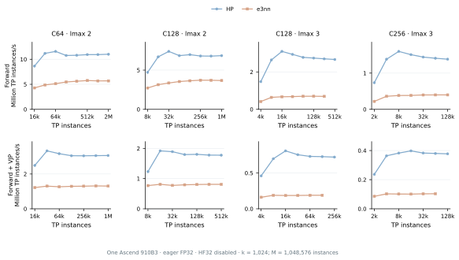
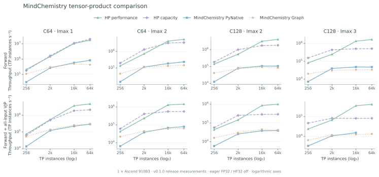
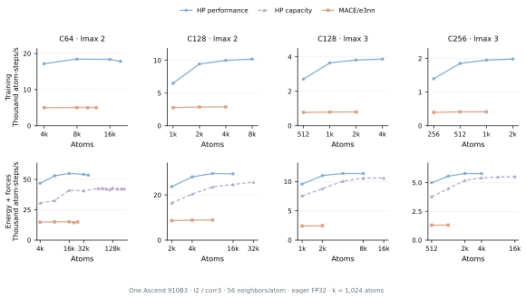
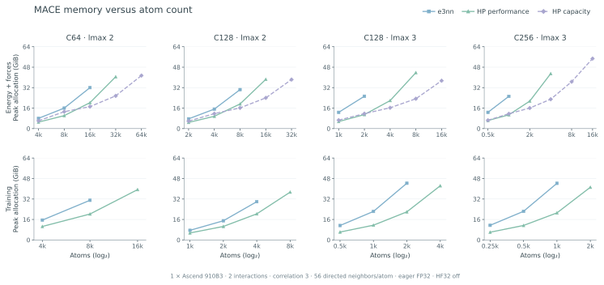
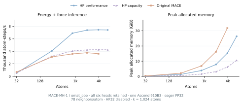
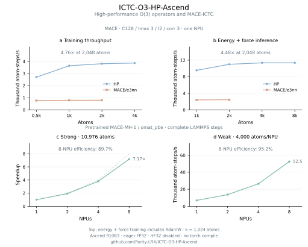

# Performance figures

Complete operator and model comparisons for ICTC-O3-HP-Ascend.
[README results](../README.md#single-npu-results) ·
[Measurement protocols and validation](USAGE.md#benchmark-protocols-and-numerical-validation) ·
[Usage guide](USAGE.md)

All figures use Ascend 910B3, eager FP32 and HF32 disabled. PyTorch results do
not use `torch.compile`. Comparison plots use blue for HP, lavender for HP
capacity and peach for the baseline. MindChemistry Graph execution uses green.

## Standalone O(3) tensor products

Columns are C64/lmax 2, C128/lmax 2, C128/lmax 3 and C256/lmax 3. The upper
row measures forward; the lower row measures forward plus gradients of
features, direction harmonics and path weights. At the largest shared sizes,
HP reaches 1.87–3.90× forward and 2.19–3.85× forward-plus-VJP throughput over
e3nn. C128/lmax 3 reaches 2.70 million TP instances/s at 262,144 instances.

[Download PNG](figures/ascend-tp-throughput.png).

## MindChemistry comparison

Columns are C64/lmax 1, C64/lmax 2, C128/lmax 2 and C128/lmax 3. Upper and
lower rows measure forward and forward-plus-VJP, respectively. These recorded
v0.1.0 measurements use MindChemistry 0.2.0 and MindSpore 2.10.0, with matching
coupling paths, normalization and live external path weights. Graph compilation
is excluded from timing. At C64/lmax 2 and 65,536 instances, HP reaches 23.18×
forward and 18.37× forward-plus-gradient throughput over MindChemistry PyNative.

[Download PNG](figures/ascend_mindchemistry_tp.png).

## MACE model sweep

### Throughput

Columns are C64/lmax 2, C128/lmax 2, C128/lmax 3 and C256/lmax 3, each with
two residual interactions and correlation 3. The upper row measures training,
including energy-and-force loss backward and AdamW; the lower row measures
energy-and-force inference. At C128/lmax 3 and 2,048 atoms, HP reaches 4.76×
training and 4.48× inference throughput over original PyTorch MACE/e3nn.

At C256/lmax 3 and 16,384 atoms, streaming the frozen radial output projection
reduces capacity-mode latency from 18.61 s to 4.55 s (4.09×), reaching
3.60k atom-steps/s. Peak allocated memory falls from 54.73 to 39.58 GiB.
These before/after measurements use the same weights, graph and NPU.

[Download PNG](figures/ascend-mace-throughput.png).

### Memory

The same columns and row order apply. Curves connect measured sizes and show
peak PyTorch allocations, including optimizer state for training. External
CANN and driver allocations are excluded. Under memory pressure, capacity mode
streams the frozen radial output projection inside message chunks; switching
to this schedule can reduce peak memory at a larger atom count. The C64 data
match the [README overview](../README.md#training-and-inference), which also
shows the measured success-to-OOM brackets.

[Download PNG](figures/ascend-mace-memory.png).

## Pretrained MACE-MH-1

All six heads are retained, with `omat_pbe` selected, a 6 Å cutoff and
78 neighbors/atom. Performance inference reaches 7,440 atom-steps/s at
4,000 atoms, 2.05× original PyTorch MACE. At that size, capacity mode uses
6.13 GiB versus 31.71 GiB for original MACE. Both HP modes complete the
6,912-atom sample, where original MACE reaches OOM. These pretrained results
retain their recorded protocol, separately from the initialized four-model sweep.

[Download PNG](figures/ascend-mh1-throughput.png) ·
[Multi-NPU scaling](../README.md#mace-mh-1-scaling) ·
[Conversion recipe](USAGE.md#6-use-mace-mh-1).

## Multi-NPU molecular dynamics

The [README](../README.md#multi-npu-scaling) shows C64 and pretrained MH-1 in
separate scaling figures. Exact latency, throughput, memory and protocol are
available in the [LAMMPS results](../lammps_user_mfftorch/docs/ASCEND.md#measured-md-performance).
Scaling figures use blue for the C64 model and green for MH-1.

[Download C64 PNG](figures/ascend_lammps_scaling.png) ·
[Download MH-1 PNG](figures/ascend_mh1_scaling.png).

## Shareable overview

The upper row uses C128/lmax 3 MACE. The lower row uses pretrained MH-1
(`omat_pbe`) in complete LAMMPS steps. [Download PNG](figures/ascend-performance-overview.png).
